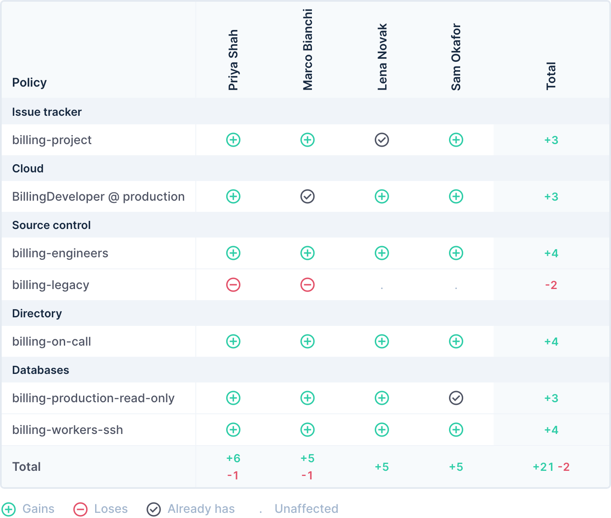
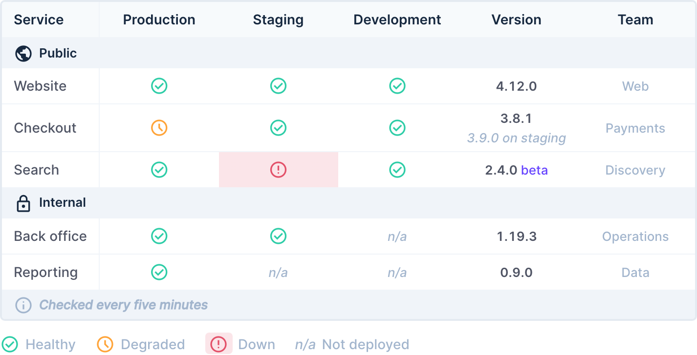
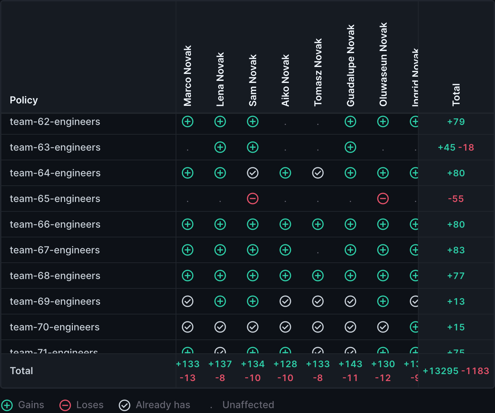

# directus-extension-json-table

[](https://www.npmjs.com/package/directus-extension-json-table)
[](https://opensource.org/licenses/MIT)

A read-only table interface for JSON fields in [Directus](https://directus.io). The field's value holds a table cell by cell (text, icons, colours, links) and the interface draws it: a header row, rows with headings between them, and a legend underneath. It is for tables which something else computes and writes, such as a flow, a hook or a script that talks to the API, and whose columns differ from item to item, which no relational interface can show.



## Features

- **Draws what it is given.** Every cell says what it shows, so the interface knows nothing about what the table means and works nothing out. Totals, groups and notes are cells and rows which the writer adds.
- **Cells with style.** Text, an icon from the Directus icon set, a colour and a background (hex colours or theme variables, which follow the light and dark themes), a font weight and italics. A cell can hold several parts with their own styles, side by side or on a line each.
- **Links.** A cell can point at an item of any collection. Clicking it opens the item in the stock side drawer, view-only, for users who may read that collection.
- **Made for large tables.** The first column stays in view while the table scrolls sideways, more rows and columns can be pinned to any edge, and column labels turn on their side when the columns do not fit across. A table of 100 by 200 cells draws in about half a second.
- **Small values.** Cells which repeat are written once and used by name, and a large table can be stored compressed with gzip, which the interface unpacks in the browser with no library.
- **Read-only, always.** The interface never changes the field's value and never marks the item as changed, whether or not the field is set to read-only.
- **Safe with any text.** The value is checked before anything is drawn, text is only ever shown as text, and colours are the only part of the value which reaches CSS. A value which breaks the format is not drawn, and the field says what is wrong with it.
- **Looks like Directus** in light, dark and custom themes, using stock components and theme tokens.
- **Self-contained.** One app extension of about 31 KB (10.5 KB gzipped) which imports only `vue` and `@directus/extensions-sdk`.

## Installation

Choose one:

- **Marketplace.** In Directus go to Settings, Marketplace, search for `json-table` and install. App-only extensions such as this one are listed under the default `MARKETPLACE_TRUST` setting.
- **npm.** In the project that runs Directus run `npm install directus-extension-json-table`. Directus discovers extensions listed in the root `package.json` on startup.
- **Local folder.** Run `npm pack directus-extension-json-table`, unpack the archive into `<EXTENSIONS_PATH>/directus-extension-json-table` (`EXTENSIONS_PATH` defaults to `./extensions`) with `tar -xzf directus-extension-json-table-*.tgz --strip-components 1 -C <that folder>`, then restart Directus. The archive holds `package.json` and `dist/`, which is all Directus needs at run time.

## Usage

1. Restart Directus if you installed via npm or a local folder, and reload the Data Studio, which fetches extensions once when it starts.
2. Settings, Extensions: confirm **directus-extension-json-table** is enabled.
3. Settings, Data Model, open a collection and create a field of type JSON. Choose **JSON Table**, in the "Other" group, and turn on **Read-only** under Field, so the form never offers to edit the value.
4. Write a value into the field. To try it, write [`examples/status-board.json`](https://github.com/dkrutsko/directus-extensions/blob/main/packages/json-table/examples/status-board.json) into the field through the API, or switch the field to the stock Code interface for a moment and paste it there. The examples are in the repository and not in the npm package, so the first command fetches the file:

	```sh
	curl -sSfO "https://raw.githubusercontent.com/dkrutsko/directus-extensions/main/packages/json-table/examples/status-board.json"

	curl -X PATCH "https://directus.example.com/items/<collection>/<id>" \
		-H "Authorization: Bearer $TOKEN" -H "Content-Type: application/json" \
		-d "{\"<field>\": $(cat status-board.json)}"
	```

5. Open the item. Links in the examples point at collections which your project does not have, so they are shown as plain text.



## Options

Every option is optional. The key and the type are for whoever sets the options through the API or a schema file, where they are the field's `meta.options`. An option which is left out, or `null`, has its default.

| Option | Key | Type | Default | Description |
|---|---|---|---|---|
| Column Labels | `columnLabels` | string | `"auto"` | `"auto"` (Automatic), `"rotated"` (On their side) or `"across"` (Across). Automatic writes the labels across while the columns fit the width of the field, and turns them on their side when they do not. |
| Maximum Height | `maxHeight` | integer | `0` | Height of the table in pixels. 0 is no limit: the table is as tall as its rows and the page scrolls. Any other height is at least 320. |
| Sticky Columns, Left | `stickyLeft` | integer, 0 to 10 | `1` | How many columns stay in view on the left while the table scrolls sideways. The first column holds the row labels. |
| Sticky Columns, Right | `stickyRight` | integer, 0 to 10 | `0` | The same on the right, for example for a column which holds totals. |
| Sticky Rows, Top | `stickyTop` | integer, 0 to 10 | `1` | How many rows stay in view at the top. The first row holds the column labels. Needs a maximum height. |
| Sticky Rows, Bottom | `stickyBottom` | integer, 0 to 10 | `0` | The same at the bottom, for example for a row which holds totals. Needs a maximum height. |
| Placeholder | `placeholder` | string | none, which shows "No table yet" | Shown while the field is empty. |

Rows can only be sticky when the height is limited, because a table without a limit never scrolls up or down by itself: the page does. The form therefore shows the two options for rows only while Maximum Height is more than 0; what was stored for them is kept, and counts again once there is a height. Sticky columns never cover more than two thirds of the width, and sticky rows two thirds of the height, so a setting which asks for more is cut back.

A table narrower than the field is stretched to fill it. The first column and the sticky columns stay as wide as their content, and the columns between them share the extra width.



## The value

The field holds `null` or an object like this:

```json
{
	"version": 1,
	"data": {
		"shared": {
			"yes": { "icon": "check_circle", "color": "var(--theme--success)", "tip": "Included" },
			"no": { "text": "-", "color": "var(--theme--foreground-subdued)", "tip": "Not included" }
		},
		"columns": [{ "text": "Feature" }, { "text": "Free" }, { "text": "Team" }],
		"rows": [
			[{ "text": "Sharing" }],
			[{ "text": "Public links" }, "yes", "yes"],
			[{ "text": "Guest accounts", "link": { "collection": "features", "id": "guests" } }, "no", "yes"],
			[{ "text": "Price", "weight": 600 }, { "text": "0" }, { "text": ["12", { "text": "per seat", "italic": true, "break": true }] }]
		],
		"legend": ["yes", "no"]
	}
}
```

- `columns` is the header row and `rows` the rows under it, each a list with one cell per column. A row with a single cell is a heading across the table.
- A cell is an object with any of `text`, `icon`, `color`, `background`, `weight`, `italic`, `tip` (the tooltip) and `link`, or the name of a cell in `shared`.
- `shared` holds cells by name. A cell can also start from one with `"use": "name"` and change some of its fields.
- `text` can be a list of parts, each with its own fields. Parts sit side by side, and a part with `"break": true` starts a new line.
- `legend` lists cells to explain under the table, each followed by its `tip`.
- A large table can be stored as `{ "version": 1, "encoding": "gzip", "data": "<base64>" }`.

[`docs/format.md`](https://github.com/dkrutsko/directus-extensions/blob/main/packages/json-table/docs/format.md) is the full reference, with the colours, the rules for shared cells and parts, compression in JavaScript, Go and Python, the limits and the error messages. [`docs/schema.json`](https://github.com/dkrutsko/directus-extensions/blob/main/packages/json-table/docs/schema.json) is a JSON Schema of the format, and [`examples/`](https://github.com/dkrutsko/directus-extensions/tree/main/packages/json-table/examples) has complete values.

## Compatibility

Built and tested against Directus 11.17.4. The `host` range, `^11.15.0`, is the one every package of this repository declares: no other version in it was tried, and Directus 12 was not either. The drawer opens an item view-only through the `nonEditable` state of the app's own drawer, so a version without that state would not do.

Version 1.0.0 was tested in Chrome, in Firefox and in WebKit, the engine of Safari, but not in Safari itself. The browser tests of the repository run in Chromium; the changes since were looked at in Firefox and WebKit, not tested there. A screen reader was not tried: the names and roles were read from the accessibility tree of Chromium. A compressed value needs a browser with `DecompressionStream`: Chrome 80, Firefox 113 or Safari 16.4.

## Limitations

- A table can have 200 columns and 1,000 rows at most, a cell 10 parts, all cells together 100,000 parts, and the legend 200 entries. A table over a limit is not drawn, and the field says which limit it broke. It is never cut, because the part left out could be the part which matters.
- Every cell is an element in the page, and there is no virtual scrolling. The largest table there can be takes about four seconds to draw in Chrome and Firefox and about six in WebKit, during which the page does not respond, and it scrolls with visible stutter. Tables of a few thousand cells are instant.
- Without a maximum height the bar for scrolling sideways sits under the last row, which can be far below the window. A trackpad, or Shift with the mouse wheel, scrolls sideways from anywhere in the table. A maximum height keeps the bar in view.
- Nothing can be sorted, filtered or searched in the table, by design: the interface shows the value as it is. The browser's own find in page works, since every cell is in the page.
- Only the icons of Material Symbols can be used. The custom and social icons which Directus also knows are not drawn.
- A link needs text, so a cell with only an icon cannot be clicked. A link to an item which does not exist opens nothing: Directus shows its own "You don't have permission to access this" notice.
- Text is cut at 200 characters, and a line never wraps.
- The fixed texts of the interface are in English only: "Unable to display this table" and the problem under it, "No table yet", "This table has no columns", "A table is not shown while several items are edited", and "Legend", the name of the legend for assistive technology. The placeholder can be changed per field. The table itself is called by the name of its field.
- While several items are edited at once, the field shows no table: there is one in every item, and not one for all of them.
- The interface is a form field only. In layouts and display templates the field shows as raw JSON, so hide it there.
- Because the interface is read-only, the value has to be written through the API, a flow or another extension.

## Development

This package lives in the [directus-extensions](https://github.com/dkrutsko/directus-extensions) repository, whose README covers the setup, the test Directus and releasing. The test Directus has a demo of the table with every option and every kind of cell side by side, [described in its README](https://github.com/dkrutsko/directus-extensions/blob/main/sandbox/README.md#demos). After `npm install` in the repository root, run these in `packages/json-table`:

```bash
npm run dev       # watch build, unminified
npm run check     # vue-tsc, then tsc over the tests
npm run build
npm test          # vitest; two of the tests read the built bundle
npm run validate
```

The code is laid out as follows:

- `src/index.ts` declares the interface and its options, and `src/interface.vue` is the component with its template and styles. `src/label.ts` draws the labels, `src/drawer.vue` is the drawer a link opens, and `src/preview.ts` the drawing in the interface picker.
- `src/table.ts` is the format: the types, the validator, the unpacking of compressed values and the pure layout helpers. `src/view.ts` works out what the component draws from a checked table and the options: the tooltips, the groups of rows, the links and the pins. Neither uses Vue, DOM or Directus APIs, so the tests run them in Node.
- `tests` holds the unit tests of the two, of the documents and of the built bundle, `sandbox` the browser tests which run in a real Directus, `examples` the example values, and `docs` the [format reference](https://github.com/dkrutsko/directus-extensions/blob/main/packages/json-table/docs/format.md) and its [JSON Schema](https://github.com/dkrutsko/directus-extensions/blob/main/packages/json-table/docs/schema.json), which a test keeps in step with the validator.

## License

[MIT](https://github.com/dkrutsko/directus-extensions/blob/main/packages/json-table/LICENSE)
