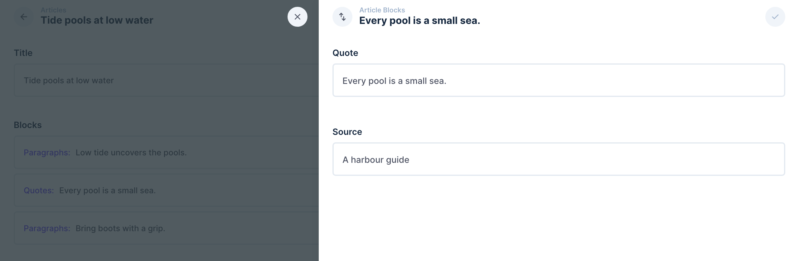

# directus-extension-list-m2a-viewable

[](https://www.npmjs.com/package/directus-extension-list-m2a-viewable)
[](https://opensource.org/licenses/MIT)

A drop-in replacement for the built-in **Builder (M2A)** interface (`list-m2a`) in [Directus](https://directus.io) that keeps list items clickable when the field is read-only. Anyone who can _see_ the field can open each referenced item in the side drawer, in view-only mode.



## Why

Since Directus 11.15 the built-in interface disables every row of its list while the field is disabled, unless the form also says that the field is "non-editable" (`app/src/interfaces/list-m2a/list-m2a.vue:388` in the source of 11.17.4). A disabled row does not react to a click, so the item behind it cannot be opened. Before 11.15 those rows still opened the drawer.

In 11.17.4 that is the case for nearly everyone who looks at a read-only M2A field on an item page:

- an administrator, and any user who may update the collection, when the field's **Readonly** toggle is on;
- a user who has no update permission on the collection at all.

The built-in rows stay clickable only where the app itself marks the form as non-editable: a field which the user's update permission leaves out, an item which the user's update rule does not cover, a singleton the user may not update, the comparison of revisions and versions, a share, and a form inside a drawer which is view-only itself.

The upstream issue is [directus/directus#26689](https://github.com/directus/directus/issues/26689). It is closed, but the change which closed it covered the many-to-many, one-to-many and many-to-one interfaces, not the Builder (M2A), whose rows are bound the same way in Directus 12.7.0.

## How

The extension renders the built-in component by its global name (`interface-list-m2a`) and tells it that the field is non-editable whenever the field is disabled. Everything else is passed on untouched, so the options and the stored data are those of the built-in interface, and a field can be switched between the two at any time.

A non-editable list has no create and select buttons, no drag handles, no remove buttons and no pagination, and the drawer it opens has disabled fields and a disabled save button. Because the pagination is gone as well, the extension adds one option, **Items Shown When Read-only**, which is the page size while the field is read-only.

One thing looks different from the built-in interface: a read-only field does not look read-only. The built-in rows of a disabled field have a subdued background and grey collection names. Here they look like the rows of a field which can be edited, with the collection names in the primary colour, since that is how the built-in component draws rows which can be clicked. What tells the field apart is that it has no buttons.

## Options

The interface has the five options of the built-in Builder (M2A), with the same keys, defaults and meaning: **Selecting Items** (`enableSelect`), **Creating Items** (`enableCreate`), **Per Page** (`limit`), **Allow Duplicates** (`allowDuplicates`) and **Prefix** (`prefix`). It adds one:

| Option | Key | Type | Default | What it does |
|---|---|---|---|---|
| **Items Shown When Read-only** | `viewLimit` | integer | `-1` | How many items the list shows while the field is read-only. `-1` shows all of them. `0`, every other negative number and anything which is not a whole number count as `-1`. |

Per Page falls back to 15 in the same way, when it holds anything but a whole number from 1 up.

## Installation

Choose one:

- **Marketplace.** In Directus go to Settings, Marketplace, search for `list-m2a-viewable` and install. App-only extensions such as this one are listed under the default `MARKETPLACE_TRUST` setting.
- **npm.** In the project that runs Directus run `npm install directus-extension-list-m2a-viewable`. Directus discovers extensions listed in the root `package.json` on startup.
- **Local folder.** Run `npm pack directus-extension-list-m2a-viewable`, unpack the archive into `<EXTENSIONS_PATH>/directus-extension-list-m2a-viewable` (`EXTENSIONS_PATH` defaults to `./extensions`) with `tar -xzf directus-extension-list-m2a-viewable-*.tgz --strip-components 1 -C <that folder>`, then restart Directus. The archive holds `package.json`, `dist/`, `README.md` and `LICENSE`; Directus needs the first two at run time.

## Usage

1. Restart Directus if you installed via npm or a local folder.
2. Settings, Extensions: confirm **directus-extension-list-m2a-viewable** is enabled.
3. Settings, Data Model, open the collection, open the M2A field, and set **Interface** to **Builder (M2A) Viewable**. Re-check its options. They match the built-in ones one-to-one.
4. Leave the field's **Readonly** toggle as it is. Items are now clickable for everyone who can read the field.

Users still need read permission on the junction collection and on every collection the field allows. Without one of them the whole field is replaced by the notice "The relationship is not configured properly or you don't have permission to access it", exactly as with the built-in interface. A single row which reads "Invalid Item" is something else: its item belongs to a collection which the field does not allow, or no longer allows, or which is a singleton. Such a row opens nothing.

## Limitations

- **Only the Builder (M2A).** The other relational interfaces are not touched.
- **A read-only field has no pagination.** With **Items Shown When Read-only** set to a number, the items after that many are not shown, and nothing says that there are more.
- **"All" loads every item in one request** and draws them in one list. For a field with thousands of items, set a number.
- **`QUERY_LIMIT_MAX` caps "all".** In a project which sets it, `-1` shows that many items and a larger number is cut down to it, again without a word.
- **The list is loaded again** whenever the field changes between read-only and editable: when its checkbox is ticked in a batch edit, or when another user takes or leaves the field in collaborative editing.
- **It relies on internals of the built-in component:** its global name and its `disabled`, `nonEditable` and `limit` props. An update of Directus can change them. If the built-in interface is not there at all, the field shows a notice which says so.

## Compatibility

Built and tested against Directus 11.17.4. The `host` range `^11.15.0` is the one every package of this repository declares, and no other version was tried. Directus 11.15.0 is also the release which made the rows of a read-only field inert, so below it there is nothing for this extension to do. Directus 12 is outside the range and was not tried.

## Development

This package lives in the [directus-extensions](https://github.com/dkrutsko/directus-extensions) repository, whose README covers the setup, the test Directus and releasing. After `npm install` in the repository root, run these in `packages/list-m2a-viewable`:

```bash
npm run dev       # watch build, unminified
npm run check     # vue-tsc, plus tsc over the tests
npm test          # vitest
npm run build
npm run validate
```

The unit tests cover the page sizes and the choice of when the list starts anew, which need no browser. Everything else is the built-in component at work, so `sandbox` holds browser tests which run in a real Directus.

## License

[MIT](https://github.com/dkrutsko/directus-extensions/blob/main/packages/list-m2a-viewable/LICENSE)
