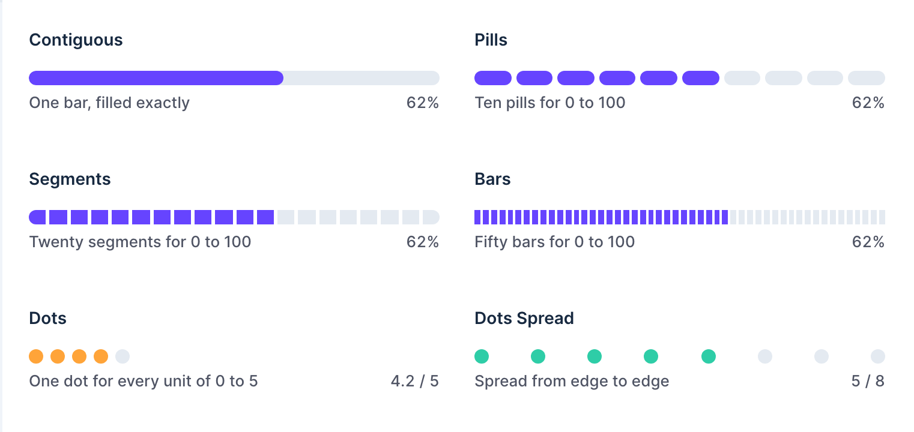
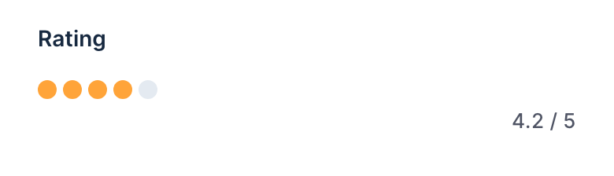
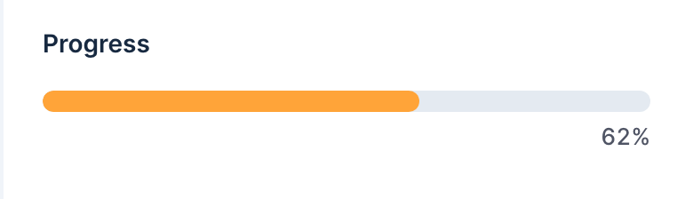
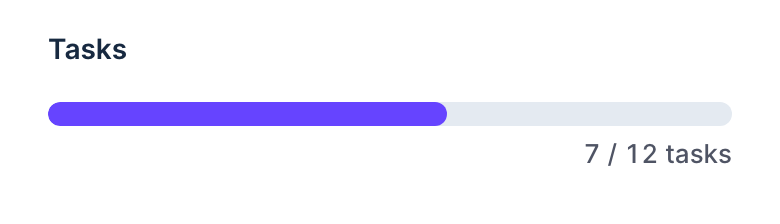
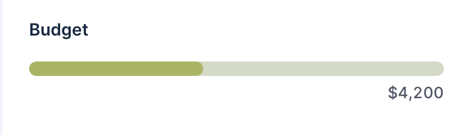
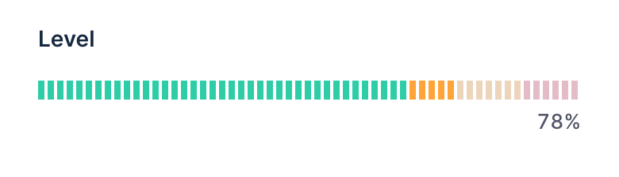
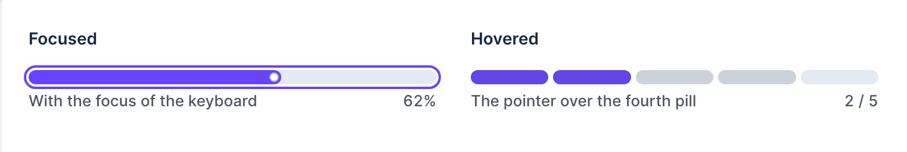
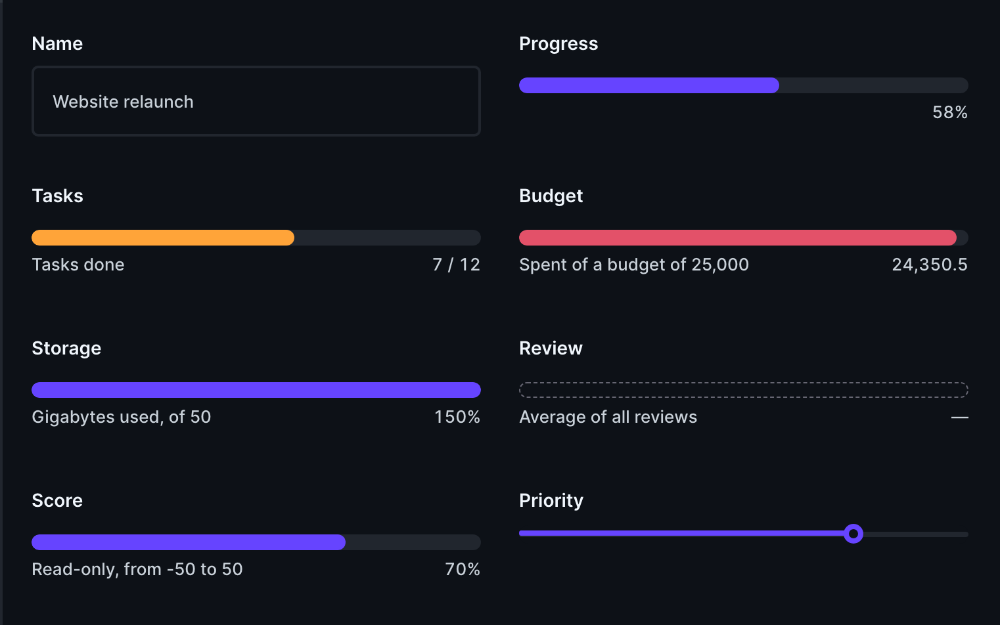

# directus-extension-meter

[](https://www.npmjs.com/package/directus-extension-meter)
[](https://opensource.org/licenses/MIT)

A meter interface and display for numeric fields in [Directus](https://directus.io): the number is drawn as a bar, or as a row of pills, segments, bars or dots, filled as far as the value has come between a minimum and a maximum, with the value as text. In a read-only field it is a reading, in a field which can be edited the same bar is the control, set with the pointer and the keys, and in a layout the display draws it in one length on every row.


## Installation

Choose one:

- **Marketplace.** In Directus go to Settings, Marketplace, search for `meter` and install. App-only extensions such as this one are listed under the default `MARKETPLACE_TRUST` setting.
- **npm.** In the project that runs Directus run `npm install directus-extension-meter`. Directus discovers extensions listed in the root `package.json` on startup.
- **Local folder.** Run `npm pack directus-extension-meter`, unpack the archive into `<EXTENSIONS_PATH>/directus-extension-meter` (`EXTENSIONS_PATH` defaults to `./extensions`) with `tar -xzf directus-extension-meter-*.tgz --strip-components 1 -C <that folder>`, then restart Directus.

Restart Directus after an install by npm or into a folder, and reload the Data Studio. Under Settings, Extensions the package shows as a bundle of two entries, the interface and the display.

## Quick start

1. In Settings, Data Model, create a field and choose **Meter**, in the "Other" group, with the type Integer, Big Integer, Float or Decimal. For a field which exists, open it and set **Interface** to **Meter**.
2. Set **Minimum Value** and **Maximum Value**. Left empty they are 0 and 100.
3. Under **Display** choose **Meter**, which the interface recommends. It needs no options of its own: it takes them from the interface.

If something else keeps the number up to date (a flow, an import, the API) and editors should not set it, tick **Readonly** in the field's settings, or set **Input Method** to "None".

## Upgrading from 1.x

- **A meter on a field which is not read-only can now be set** with the pointer and the keys. In 1.x a meter never changed its field.
- **To keep a reading,** tick **Readonly** in the field's settings, or set the meter's **Input Method** to "None". With "None" the field can still be changed by other means, such as **Edit Raw Value**.
- **Nothing which 1.x stored changes its meaning.** The seven options of 1.x (`min`, `max`, `label`, `indicator`, `indicatorFormat`, `color`, `thresholds`) are read as before, and so is the value of the field.
- **A field which sets none of the new options looks as it did.** Where it can be edited it also has a pointer cursor, a small handle at the end of the fill while it is used, and a focus ring.
- The display is never edited.

The [changelog](https://github.com/dkrutsko/directus-extensions/blob/main/packages/meter/CHANGELOG.md) lists everything which is new in 2.0.

## Options

Every option is optional. "Display" says whether the display has the option too; where it does and sets none of its own, it takes the interface's (see [The display](#the-display)). The form shows the words of a dropdown capitalised ("Pills", "Position"), and `fraction` as "Value / Maximum".

| Name | Key | Type | Default | What it does | Display |
|---|---|---|---|---|---|
| Minimum Value | `min` | number | `0` | The value at which the bar is empty. | yes |
| Maximum Value | `max` | number | `100` | The value at which the bar is full. A minimum above the maximum is read as the two swapped. | yes |
| Label | `label` | text | none | A caption under the bar, at the start of the line which has the value at its end. A long one wraps. It can be a translation string of the project. It is also the name of the meter for a screen reader; without one that is the name of the field. In a layout it is in the tooltip. | yes |
| Value Text | `indicator` | on or off | on | Shows the value as text: under the bar in the form, beside it in a layout. | yes |
| Format | `indicatorFormat` | `percent`, `value`, `fraction` | `percent` | What the text says: how far the value has come ("58%"), the value itself ("7") or the value over the maximum ("7 / 12"). Numbers follow the language of the user. The percentage is whole, and says "0%" and "100%" only when they are true. | yes |
| Prefix | `prefix` | text | none | Text before the number, for `value` and `fraction`: "$" gives "$4,200". A fraction has it before both numbers. Joined on as typed, with no space added. | yes |
| Suffix | `suffix` | text | none | Text after the value text, for `value` and `fraction`: " GB" gives "42 GB", so type the space. A fraction has it once, at the end. | yes |
| Visualization | `visualization` | `contiguous`, `pills`, `segments`, `bars`, `dots` | `contiguous` | One bar which is filled exactly, or a row of pieces which are each filled or not: pills with round ends, segments which read as one cut bar, thin square bars, or dots. The nearest whole number of pieces is filled; the text keeps the exact value. | yes |
| Subdivisions | `subdivisions` | whole number, 2 or more | automatic | How many pieces are wanted. Empty: one for every unit of the range where that is a whole number of at least 2, else as many as fit. Where the number does not fit the width, fewer are drawn: for pills and segments a number which divides it, so each piece is a round share. At most 200. | yes |
| Dots Layout | `dotsLayout` | `packed`, `spread` | `packed` | Where dots stand: from the start, a fixed distance apart, or from edge to edge with equal gaps. | yes |
| Grow | `grow` | number, 0 to 20 | `0` | Above 0, the pieces which are not filled are drawn small and grow as the value nears them. The number is how many can be growing at once: 1 for the next piece only (the next two or three where the bars are thin), more for a ramp. | no |
| Fade In | `fade` | on or off | off | The next piece takes on the colour of a filled one gradually, as the value nears it. With a Grow above 1, or thin bars, the next few do. | yes |
| Color | `color` | hex colour or `var(--theme--...)` | the primary colour | The colour of what is filled. The text input of the colour picker also takes a theme variable, typed in: `var(--theme--danger)` follows the theme. | yes |
| Thresholds | `thresholds` | list of `{ "value", "color" }` | none | From its value upward the bar has the colour of an entry; the highest one the value has reached counts. Values are in the units of the field. | yes |
| Active Coloring | `activeColoring` | `value`, `blend`, `steps`, `gradient` | `value` | The colours of what is filled. `value`: one colour, that of the current value. `blend`: one colour which shifts towards the next threshold's as the value nears it. `steps`: each place on the track has the colour of its own threshold. `gradient`: those colours blended along the track. | yes |
| Inactive Coloring | `inactiveColoring` | `plain`, `automatic`, `value`, `blend`, `steps`, `gradient` | `plain` | The colours of what is not filled. `plain`: the track. `automatic`: as what is filled, faded. The other four: that colouring, faded. | yes |
| Input Method | `input` | `automatic`, `position`, `piece`, `relative`, `none` | `automatic` | How the pointer sets the value: see [Editing](#editing). `none`: the meter is not edited. | no |
| Step | `step` | number above 0 | by type and range | The distance between two values which can be set, counted from the minimum. Empty: 1 on an Integer or Big Integer field; on a Float or Decimal field the largest power of ten which gives the range at least a hundred steps, at most 1: 0.01 for 0 to 1, 0.1 for 0 to 10, 1 from a range of 100 on. The form shows what it comes to. | no |
| Sensitivity | `sensitivity` | number above 0 | `1` | For `relative`: how many times the range one length of the meter covers. | no |

Options which apply only sometimes are hidden in the form until they do: Subdivisions, Grow and Fade In need pieces, Dots Layout needs dots, Prefix and Suffix a format other than the percentage, Sensitivity the method "Relative", and Step any method but "None".




## Recipes

Each is the options of the interface as the field stores them (`meta.options`). Set them in the field's Interface options under Settings, Data Model, or send them with `PATCH /fields/<collection>/<field>`. The display follows without options of its own.

**A rating of five dots, set by piece.** A click on the fourth dot sets 4, on any numeric type.



```json
{ "max": 5, "visualization": "dots", "input": "piece", "indicatorFormat": "fraction", "color": "#FFA439" }
```

**A percentage in red, amber and green.** Red below 50, amber from 50, green from 80.



```json
{ "color": "#E35169", "thresholds": [{ "value": 50, "color": "#FFA439" }, { "value": 80, "color": "#2ECDA7" }] }
```

**A count as a fraction, with a suffix.**



```json
{ "max": 12, "indicatorFormat": "fraction", "suffix": " tasks" }
```

**A budget with a prefix, a blend and a faded track.** The fill shifts from green towards amber at 7,000 and red at 9,000, and the rest of the track is a faded tint of it.



```json
{ "max": 10000, "indicatorFormat": "value", "prefix": "$", "color": "#2ECDA7", "thresholds": [{ "value": 7000, "color": "#FFA439" }, { "value": 9000, "color": "#E35169" }], "activeColoring": "blend", "inactiveColoring": "automatic" }
```

**A level meter of thin bars.** As many bars as fit, green, amber from 70 and red from 90 by their place, with the bars which are not filled in the same colours, faded.



```json
{ "visualization": "bars", "color": "#2ECDA7", "thresholds": [{ "value": 70, "color": "#FFA439" }, { "value": 90, "color": "#E35169" }], "activeColoring": "steps", "inactiveColoring": "automatic" }
```

**A reading on a field which can be edited.** The meter takes no press and no key, and the field can still be changed with **Edit Raw Value**.

```json
{ "input": "none", "label": "Kept up to date by a flow" }
```

## The display

The **Meter** display draws a short bar of a fixed length and then the text, on one line (the second picture above). Every bar is the same length, so a column can be compared at a glance.

- **Where it works.** It is inline content. The browser tests cover the table layout and the template of a related item. Where Directus needs plain text instead, as in the titles of the calendar layout, the display gives the value text, such as "58%" or "42 GB".
- **Configured once.** An option which the display does not set is taken from the interface of the field, each on its own. Its options form shows what it takes over. It also reads the limits of the stock Input and the stock Slider.
- **An option which is set is the display's own.** Emptied again, it is taken from the interface again, with two exceptions: an emptied **Color** or list of **Thresholds** means none, also where the interface has some.
- **Pieces** are drawn in a layout too, the same number in every row: at most 7 pills, 9 segments, 24 bars or 9 dots.
- **The caption** is in the tooltip, in front of the value.
- **It is never edited,** and its pieces never grow.
- **A field without a value** shows the dash Directus shows for every empty field.

## Editing



A meter in a form is edited wherever its field can be: not in a read-only field, not where a condition or the permissions of the user disable it, and not with the input method "None".

- **"Position":** a press sets the value under the pointer, and a drag follows it. On a meter in pieces, the pieces which that value fills are drawn larger while the pointer is over the meter.
- **"Piece":** a press fills the pieces up to the one under the pointer. Those pieces are drawn larger while the pointer is over the meter.
- **"Relative":** a press changes nothing; the value moves by as much as the pointer moves, ten times finer with Shift. The pointer is locked for the drag where the browser allows it.
- **"Automatic":** "Piece" where every piece is exactly one step, as five dots on an Integer field from 0 to 5; "Position" otherwise. A Float field from 0 to 5 drawn as five pieces is set by position in hundredths: set **Step** to 1 or the method to "Piece" for whole pieces.
- **A finger** sets the value with a tap or a sideways drag; a vertical one scrolls the page.

| Key | What it does |
|---|---|
| Right, Up / Left, Down | One step up or down. Left and Right swap in a right-to-left language. |
| Page Up, Page Down | Ten steps, or one piece where that is more. |
| Home, End | The least and the most which can be set. |
| Escape | During a drag: puts the value back. |

**What is written** is a plain number on the steps, counted from the minimum, within the range, and whole on an Integer or Big Integer field. The maximum can always be set. On a Decimal field the default step is never finer than the column holds. **Nothing is written** by a press where the value already is, by a meter which is a reading, or to clear the value: **Clear Value** in the menu of the field's label does that.

## Accessibility and themes



- **Roles.** A reading has the role `meter`, a meter which can be edited the role `slider` and one tab stop. Both say their range, their value and the text which is printed.
- **Names.** The caption, or else the name of the field. A field without a value says "No value".
- **Right-to-left.** The bar fills from the right and the arrow keys swap. Numbers keep their order.
- **Themes.** Colours come from the theme's tokens, so light, dark and custom themes work.
- **Reduced motion.** The only animations are short ones of pieces which grow, fade in or lie under the pointer. None plays for a user who asked for less motion.
- **Forced colours.** Under a contrast theme of the system the bar is drawn in the system's colours: an outline for the track, the highlight colour for what is filled.
- **Print.** A printed form or table keeps its bars.

## Compatibility

- **Directus.** Built and tested against 11.17.4. The `host` range starts at 11.15.0; earlier versions in that range and Directus 12 were not tried.
- **Browsers.** The browser tests run in Chromium, the engine of Chrome and Edge. Editing was not tried in Firefox or Safari, on a touch device or with a screen reader. Forced colours and print were tried as Chromium emulates them. Faded and blended colours need `color-mix()`, and a gradient in a right-to-left page needs `:dir()`.
- **A stock Repeater.** A Meter can be the interface of a field of a Repeater, and the display can draw its rows.
- **Coming from the stock Slider or Input.** Directus keeps the options of a field when its interface changes. A field which was a Slider keeps that Slider's limits and step, and the Meter uses them where its own are not set. A field which was an Input brings its `min`, `max` and, where one was set there, its `step` along: they are the Meter's own keys.

## Limitations

- Horizontal, in one height. There is no round gauge, no target marker and no option for the number of decimals.
- A piece is filled or not, and how many pieces a meter has depends on its width: it can differ between the form and a layout.
- **The value text is shown whole or not at all.** A table column of the default width has no room for a text such as "$4,200" beside the bar: widen the column. The tooltip keeps the text.
- Bars are drawn in whole pixels of the screen, so a row of bars can end a little before its field does, and their number can change with a zoom of the page.
- No gesture types a number or clears the value.
- A threshold means "from this value upward". There are no other comparisons.
- The prefix and the suffix are joined on as typed in every language.
- Under forced colours the colours of the options are not shown.
- A touch which drifts sideways before it scrolls the page moves the value for a moment, until the browser takes the gesture over and the value is put back.
- A **Step** which is set finer than a Decimal column holds writes values which the database rounds. The default step on a Decimal field was not tried on a database with real decimal columns.
- The names and notes of the package's own options are in English only.

## The rules in full

[`docs/behaviour.md`](https://github.com/dkrutsko/directus-extensions/blob/main/packages/meter/docs/behaviour.md) has every rule exactly: how many pieces are drawn and at which sizes, `grow` and `fade`, the colourings, the input methods, the step, what is written, and when the text is left out.

## Development

This package lives in the [directus-extensions](https://github.com/dkrutsko/directus-extensions) repository, whose README covers the setup, the test Directus and releasing. The test Directus has a demo of the meter with its options side by side, in a form and in a table, [described in its README](https://github.com/dkrutsko/directus-extensions/blob/main/sandbox/README.md#demos). [`AGENTS.md`](https://github.com/dkrutsko/directus-extensions/blob/main/packages/meter/AGENTS.md) describes the code and its tests.

## License

[MIT](https://github.com/dkrutsko/directus-extensions/blob/main/packages/meter/LICENSE)
