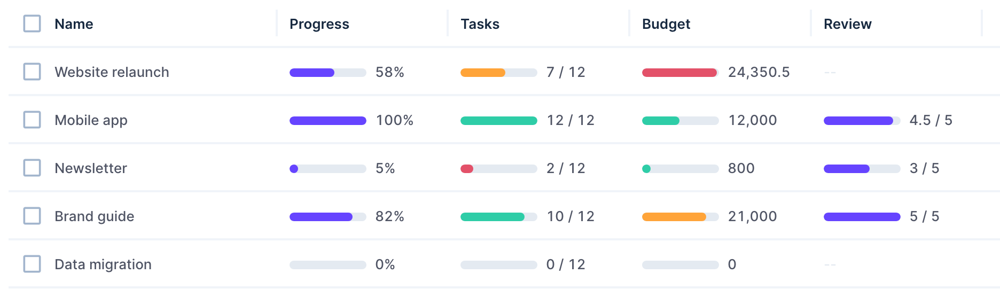

# directus-extension-meter

[](https://www.npmjs.com/package/directus-extension-meter)
[](https://opensource.org/licenses/MIT)

A meter interface and display for [Directus](https://directus.io). A number which something else keeps up to date, such as a completion percentage written by a flow, a score, a quota used or a count of finished tasks, is drawn as a bar which is filled as far as the value has come between a minimum and a maximum, with the value as text beside it. It is a reading, not an input: nothing in it changes the field. The stock Slider is the control for such a number, and looks like a greyed-out control when the field is read-only; the stock displays show the number, not where it stands in its range. The display draws the same bar in a layout, in the same length on every row, so a column can be compared at a glance.


## Features

- **A bar against a range.** Any minimum and maximum, negative and fractional ones included. Without any, the range is 0 to 100.
- **The value as text,** at the end of the row: the percentage ("58%"), the value itself ("7") or the value over the maximum ("7 / 12"), written the way the language of the user writes numbers. It can be switched off.
- **Honest at the edges.** The percentage is a whole number, but a value which is not yet at the maximum never reads "100%", and one which has left the minimum never reads "0%". A value beyond the range fills or empties the bar and prints what it is, such as "150%". A field without a value has a dashed outline and a dash, and does not pass for a field at zero.
- **Colour by value.** A list of thresholds gives the bar another colour from a value upward: red below 50, amber from 50, green from 80. It works in the form and in every layout.
- **A caption** under the bar, at the start of the line which has the value at its end, typed in or picked from the translation strings of the project.
- **A display for layouts.** A short bar and the text, on one line: in the table at every row height, in cards, in the templates of related items and in the title of an item. Every bar is the same length.
- **Configured once.** The display takes every option which it does not set itself from the interface of the field. It also reads the limits of the stock Input and the stock Slider, so it works on a field of either without any options.
- **Lines up with the form.** Everything of the meter is inside an area as high as a stock input: the bar across the field, and under it one line with the caption and the value. The note of a field is therefore where it is under an input, and a meter beside an input, a dropdown or a toggle takes the same room. There is no box around it: it is a reading, not an input. The text is in the app's size and colour.
- **The same in every state.** A read-only field is not dimmed: a number which a flow maintains is normally read-only, and it stays as legible as any other.
- **A real meter for assistive technology:** the role `meter` with its range, its value and the text which is printed, named by the caption or else by the field.
- **Looks like Directus** in light, dark and custom themes, follows right-to-left languages, and has no animation.
- **Self-contained.** One app bundle of about 14 KB which imports only `vue` and `@directus/extensions-sdk`.


## Installation

Choose one:

- **Marketplace.** In Directus go to Settings, Marketplace, search for `meter` and install. App-only extensions such as this one are listed under the default `MARKETPLACE_TRUST` setting.
- **npm.** In the project that runs Directus run `npm install directus-extension-meter`. Directus discovers extensions listed in the root `package.json` on startup.
- **Local folder.** Run `npm pack directus-extension-meter`, unpack the archive into `<EXTENSIONS_PATH>/directus-extension-meter` (`EXTENSIONS_PATH` defaults to `./extensions`) with `tar -xzf directus-extension-meter-*.tgz --strip-components 1 -C <that folder>`, then restart Directus. The archive holds `package.json` and `dist/`, which is all Directus needs at run time.

## Usage

1. Restart Directus if you installed via npm or a local folder, and reload the Data Studio, which fetches extensions once when it starts.
2. Settings, Extensions: confirm **directus-extension-meter** is enabled. It is a bundle of two entries, the interface and the display.
3. Settings, Data Model, open a collection and create a field. Choose **Meter**, in the "Other" group beside the Slider, and one of the types Integer, Big Integer, Float or Decimal. To use it for a field which already exists, open the field and set **Interface** to **Meter**.
4. Set the range, and under Display pick **Meter**, which the interface suggests. The display needs no options of its own.

The meter only shows the field. The value comes from wherever else it is written: a flow, the API, an import, or **Edit Raw Value** in the menu of the field's label. For a number which editors should not change that way, make the field read-only; the meter looks the same.

### Options

Every option is optional.

| Key | Name | Default | Description |
|---|---|---|---|
| `min` | Minimum Value | `0` | The value at which the bar is empty. |
| `max` | Maximum Value | `100` | The value at which the bar is full. |
| `label` | Label | none | A caption under the bar, at the start of its line. A long one wraps, and the field grows with it. It can be typed in, or picked from the translation strings of the project. It is also the name of the meter for a screen reader; without one that is the name of the field. |
| `indicator` | Value Text | on | Shows the value as text under the bar, at the end of the line. |
| `indicatorFormat` | Format | `percent` | What the text says. `percent`: how far the value has come in the range, "58%". `value`: the value itself, "7". `fraction`: the value over the maximum, "7 / 12". |
| `color` | Color | the primary colour | The colour of the bar. The colour picker stores a hex colour; a theme variable such as `var(--theme--danger)` can be written by hand. |
| `thresholds` | Thresholds | none | A list of entries with a `value` and a `color`. From its value upward the bar has the colour of an entry. |

How they are read:

- **The range.** A limit is a number, or the text of a number. Anything else counts as not set, and each limit has its own default. A minimum above the maximum counts as the two swapped. When both are the same number, the bar is empty below that number and full from it upward.
- **Thresholds.** The bar takes the colour of the entry with the highest `value` which the field's value has reached, and the `color` option while it is below all of them. The order of the list does not matter. An entry without a number or without a colour is left out. Values are in the units of the field, not in percent, and may lie outside the range: an entry at 101 colours only what is over a maximum of 100.
- **Colours.** A colour is a hex colour (`#RGB`, `#RGBA`, `#RRGGBB` or `#RRGGBBAA`) or one theme variable (`var(--theme--...)`). Anything else, which only a schema written by hand can hold, is ignored, and the default is used.

### What the text says

| Format | 7 of 0 to 12 | 150 of 0 to 100 | 0.4 of 0 to 100 |
|---|---|---|---|
| `percent` | 58% | 150% | 1% |
| `value` | 7 | 150 | 0.4 |
| `fraction` | 7 / 12 | 150 / 100 | 0.4 / 100 |

- The percentage is rounded to a whole number. A value strictly inside the range prints at least 1% and at most 99%, so the text says "0%" and "100%" only when they are true.
- The value and the maximum are printed with at most two decimals, and a number below 1 with its first two digits which count, so 0.004 is not "0". A number of sixteen digits or more, or one below a millionth, is written with an exponent.
- Numbers follow the language of the user: the decimal mark, the grouping of thousands and the place of the percent sign. German prints "1.250,5" and "58 %".
- The text is always whole. Beside a caption it keeps its place at the end of the line and the caption wraps; in a field too narrow for a few words of caption beside it, it goes under the caption. In a field narrower than the text itself it is left out. A screen reader hears the value either way.

### Values outside the range, and no value

- **Beyond the range** the bar stays within its track, full or empty, and the text is not held back: 150 of 100 prints "150%", and -20 prints "-20%". The number is what says that the value is beyond the range.
- **Just above the minimum** the bar shows a dot, as wide as the bar is high, so the smallest value can be told from none.
- **A field without a value** (`null`, as on a new item without a default) is not a field at zero: the track is a dashed outline without a fill, the text is a dash, and a screen reader hears "No value" in the language of the user. A value which is not a number, which only a field of another type could hold, is treated the same.

### By value, in the form

The conditions of a field (Settings, Data Model, the field, **Conditions**) can replace any option while a rule on the item matches, as for every interface: another caption below 20, for example. They apply in the form only. For a colour by value which also shows in layouts, use the thresholds.

## The display



The **Meter** display (`meter`) is for the same field in a layout. It draws a bar of a fixed length, 4.5rem, and then the text, on one line.

- **It has the options of the interface,** under the same keys: `min`, `max`, `label`, `indicator`, `indicatorFormat`, `color` and `thresholds`.
- **An option which was never set is taken from the interface of the field,** each on its own. A field which is set up with the Meter interface needs no display options at all, and its form and its layouts cannot disagree. The options form of the display shows what it takes over: the limits and the caption as placeholders, the rest as the state of its inputs. Nothing of that is stored until an option is changed.
- **An option which is set is the display's own,** whatever the interface has. So a field which had display options before, with a range, caption or colour other than its interface's, keeps drawing by them.
- **An option which is emptied again** depends on which one it is, and the options form always shows what is drawn. Emptied limits and an emptied caption are taken from the interface again, and their placeholders say so. An emptied colour or list of thresholds stays empty and means none here: the primary colour, and no thresholds, also where the interface has some.
- **The limits of stock interfaces are understood too:** `min` and `max` of the stock Input, and `minValue` and `maxValue` of the stock Slider. So the display works on a field of either, as it is.
- **Without any options anywhere** the range is 0 to 100.
- **The caption has no room in a layout.** It is in the tooltip which shows when the mouse rests on the bar, in front of the value, and it is the name of the meter for a screen reader.
- **The text is whole, or it is left out.** A column without room for the whole text beside the bar shows the bar alone, without an ellipsis; the tooltip and a screen reader still have the value. A column of the default width has room for "100%". A longer text, such as "35 / 60" or "24,350.5", needs a wider column. A column narrower than the bar cuts the bar at the edge of the cell. In a display template the bar and the text are each one piece: where one does not fit the line, the ellipsis of the template stands for it.
- **A number never shows in part,** in the display or in the form, in any language and in either direction. A part of a number reads as another number, whether it is its first digits or its last, with or without an ellipsis after it.
- **A field without a value** shows the dash Directus shows for every empty field. A value which is not a number is shown as it is.
- **Where Directus needs plain text** instead, as in the titles of the calendar layout, the display gives the text beside the bar, such as "58%" or "7 / 12".

A display can therefore have another range, caption, colour or list of thresholds than its interface, and no colour or thresholds where the interface has some. It cannot have no caption where the interface has one. Once the colour or the thresholds of a display were set or emptied, they no longer follow the interface.

## The value

The field holds a plain number, and neither entry ever writes it. Filters, the API and other displays see what they would see with any other interface. A `decimal` or a `bigInteger` which the database returns as text is read as its number; a number too large to be held exactly is drawn at the nearest value which can.

## Compatibility

Built and tested against Directus 11.17.4. The `host` range starts at 11.15.0, but only 11.17.4 has been tested. It has not been run against Directus 12.

The browser tests run in Chrome. The form and the table were also looked at in Firefox and Safari's engine, where they draw the same; it has not been tried with a screen reader.

### Coming from the stock Slider or Input

Directus keeps the options of a field when its interface changes. A field which was a Slider keeps its `minValue` and `maxValue`, and the Meter reads them wherever its own `min` and `max` are not set, so the range carries over; the options form shows them as the placeholders of the two limits. `min` and `max` of the stock Input are the Meter's own keys. The other options of both are ignored.

A field can end up with both pairs, for example one which was a Meter or an Input with `min` and `max` and was then made a Slider with limits of its own. `min` and `max` then count, for the interface and for the display alike. That is also what the stock Slider of Directus 11.17.4 draws on such a field: it runs from `min` to `max` whatever its own two options say. To give such a field another range, change `min` and `max`, which the options form of the Meter has as its two limits.

## Limitations

- It does not edit the value. Use the stock Slider or Input for that, or **Edit Raw Value**.
- One bar, horizontal, in one height. There is no ring, no segments, no target marker and no gradient.
- A threshold means "from this value upward". There are no other comparisons.
- A minimum above the maximum is read as the two swapped, not as a meter which runs backwards.
- The text has no prefix or suffix. A unit can go into the caption.
- The names of the options "Value Text" and "Thresholds", their notes, the notice in the options form of the display and the choice "Value / Maximum" are in English only. The caption, "No value" and the numbers follow the language of the user.

## Development

This package lives in the [directus-extensions](https://github.com/dkrutsko/directus-extensions) repository, whose README covers the setup, the test Directus and releasing. After `npm install` in the repository root, run these in `packages/meter`:

```bash
npm run dev       # watch build, unminified
npm run check     # vue-tsc, then tsc over the tests
npm test          # vitest
npm run build
npm run validate
```

The code is laid out as follows:

- `src/interface.ts` declares the interface, `src/interface.vue` is the meter of the form with its template and styles, and `src/preview.ts` is the drawing in the interface picker.
- `src/display.ts` declares the display with its text form, and `src/display.vue` draws it.
- `src/options.ts` is the options form which both entries share.
- `src/meter.ts` is everything which needs no browser: what the options and a value come to, how much of the track is filled, in which colour, and what the text says. It uses no Vue, DOM or Directus APIs, so the tests run it in Node.
- `tests` holds the unit tests of `src/meter.ts` and `src/options.ts`, and `sandbox` the browser tests which run in a real Directus.

## License

[MIT](https://github.com/dkrutsko/directus-extensions/blob/main/packages/meter/LICENSE)
