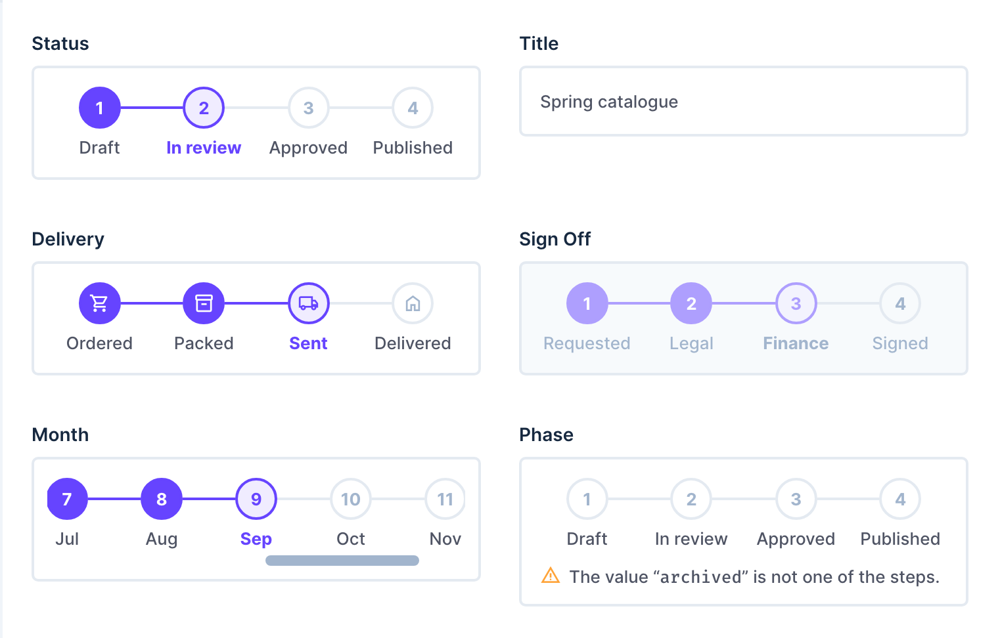
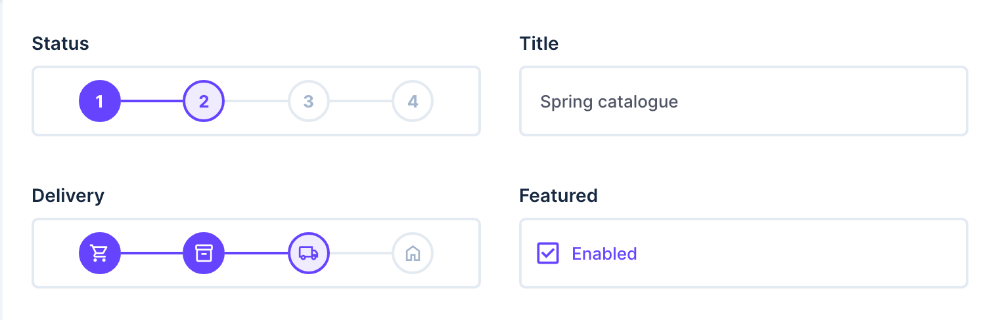
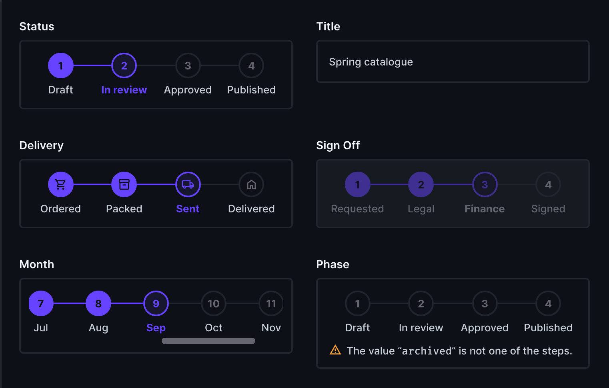
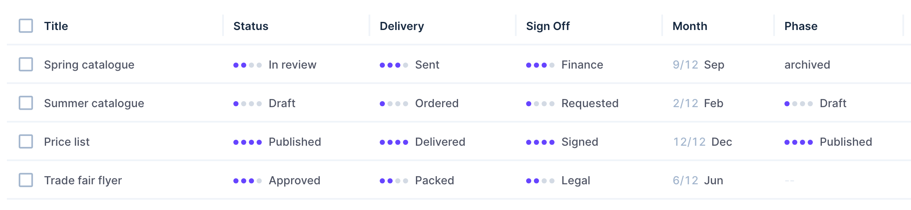

# directus-extension-steps

[](https://www.npmjs.com/package/directus-extension-steps)
[](https://opensource.org/licenses/MIT)

A steps interface and display for [Directus](https://directus.io). A field which holds one value out of an ordered list, such as the stage of a workflow, is drawn as a progress track: a numbered marker per step joined by a line, the steps already passed filled in, the current one marked. A click on a step makes it the current one. It is for fields where the order carries meaning and an editor should see at a glance how far an item has come, which a dropdown hides until it is opened. The display shows the same in a layout: a pip per step and the label of the current one.



## Features

- **Progress at a glance.** Every step is on one row, in its order. The steps before the current one have a filled marker, the current one is ringed in the primary colour with its label in bold, and the steps still to come have an empty marker. Their labels stay as readable as any other text of the form: a step which is still to come is a choice on offer.
- **One click to move on, or back.** Any step can be chosen at any time. The field stores the value of that step, exactly as the stock Dropdown would.
- **Text and whole numbers.** The field is a string or an integer. On an integer field the steps hold numbers, the field stores a number, and the track still shows its step after a reload.
- **Fits the form.** The box takes its border, radius, background and its hover, focus and disabled looks from the same theme tokens as the stock inputs, and the text is the app's size.
- **Compact when you want it.** The labels of a field can be switched off. The box is then the markers alone and exactly as high as a stock input, so it lines up with the input or toggle beside it, and the name of a step shows as a tooltip, for the mouse and for the keyboard.
- **Any number of steps.** Every step has a column of the same width, so the line always joins the markers. When the steps do not fit, the track scrolls sideways inside the box, with a scrollbar which shows, and the current step is brought into view. A step which is clicked stays under the pointer: the track only moves as far as it takes to show that step whole.
- **Icons,** or the number of the step: each step can carry an icon from the icon picker in its marker.
- **Nothing is lost quietly.** A field which holds a value that is not one of the steps says so and names the value, instead of looking empty. A field without steps shows the notice the stock Radio Buttons show.
- **Read-only done properly.** A read-only field is dimmed, skipped by the Tab key and never changes. In the comparison of revisions the track keeps its full colours and is just as inert.
- **Real buttons in a list.** Every step is a `button` in an ordered list with a name. Enter and Space choose a step, the arrow keys, Home and End move along the track without changing anything, and a screen reader hears the label, the position and which step is the current one.
- **A display for layouts.** A pip per step, filled up to the current one, and the name of the current step, on one line: in the table, in cards and in the templates of related items. It needs no options, since it reads the steps of the field.
- **The same data as the stock Dropdown.** The option which holds the steps and its keys are the Dropdown's, so a field can move between the two interfaces without touching its options or its data.
- **Looks like Directus** in light, dark and custom themes, follows right-to-left languages, and does not animate for people who ask for less motion.
- **Self-contained.** One app bundle of about 19 KB which imports only `vue` and `@directus/extensions-sdk`.





## Installation

Choose one:

- **Marketplace.** In Directus go to Settings, Marketplace, search for `steps` and install. App-only extensions such as this one are listed under the default `MARKETPLACE_TRUST` setting.
- **npm.** In the project that runs Directus run `npm install directus-extension-steps`. Directus discovers extensions listed in the root `package.json` on startup.
- **Local folder.** Run `npm pack directus-extension-steps`, unpack the archive into `<EXTENSIONS_PATH>/directus-extension-steps` (`EXTENSIONS_PATH` defaults to `./extensions`) with `tar -xzf directus-extension-steps-*.tgz --strip-components 1 -C <that folder>`, then restart Directus. The archive holds `package.json` and `dist/`, which is all Directus needs at run time.

## Usage

1. Restart Directus if you installed via npm or a local folder, and reload the Data Studio, which fetches extensions once when it starts.
2. Settings, Extensions: confirm **directus-extension-steps** is enabled. It is a bundle of two entries, the interface and the display.
3. Settings, Data Model, open a collection and create a field. Choose **Steps**, in the "Selection" group, and the type String or Integer. To use it for a field which already exists, open the field and set **Interface** to **Steps**.
4. Add the steps under **Steps**, in the order in which they should be drawn, and under Display pick **Steps**, which the interface suggests.

The interface has two options.

**Steps** (`choices`) is the list of steps. Each step has:

| Key | Name | Description |
|---|---|---|
| `text` | Text | Optional. The label under the marker, and the name of the step. It can be typed in, or picked from the translation strings of the project, as in the stock interfaces. A step without a text has no label and is named by its value. |
| `value` | Value | What the field stores while the step is the current one. On an integer field the input takes whole numbers only. |
| `icon` | Icon | Optional. An icon for the marker, in place of the number of the step. |

**Show Labels** (`showLabels`) is a switch for the whole field, on by default, and on for a field which was set up before the option existed. Switched off, no step shows a label, whatever its text: see "Steps without labels" below.

Some steps are left out without a message when the track is drawn: a step without a value, a step whose value an earlier step already has (`2` and `"2"` count as the same value), and, on an integer field, a step whose value is not a whole number, which could never be saved. The numbers in the markers count the steps which are drawn. The options themselves are not changed.

A label has room for two lines in the column of its step. A longer one is cut with an ellipsis, and resting the mouse on that step shows the whole text.

### Steps without labels

The *name* of a step is its text, or its value when it has no text. The name is what a screen reader announces, what the display shows in layouts, and what a tooltip shows. The *label* is the text of a step drawn under its marker, and nothing else is ever drawn there.

- To hide the label of one step, leave its text empty. The step is then named by its value.
- To keep the texts and hide all labels, switch **Show Labels** off.

A step without a label shows its name as a tooltip, when the mouse rests on it and when it is reached with the keyboard, so it can still be told from its neighbours. Icons help here: a marker with an icon says more than a number.

When no step of the field has a label, because **Show Labels** is off or because no step has a text, the field is drawn in its compact form: the markers alone, centred in a box exactly as high as a stock input, with narrower columns, since there is no text to make room for. When at least one step has a label, the row of labels stays and the steps without one simply have none.

An icon is one of the icon picker. A name which Directus has no icon for, which only a schema written by hand can hold, shows as the first letter of the name in the marker and never outside it.

### Keyboard

| Key | What it does |
|---|---|
| Tab, Shift + Tab | To the next and the previous step. Every step is a tab stop. |
| Enter, Space | Makes the step which has the focus the current one. |
| Left, Right | Moves the focus to the neighbouring step. In a right-to-left language the two are turned around. |
| Home, End | Moves the focus to the first and the last step. |

The arrows, Home and End never change the value, so a stray key cannot move a workflow.

## The display



The **Steps** display (`steps`) is for the same field in a layout. It shows a row of pips, one per step and filled up to and including the current one, and then the name of the current step. **Show Labels** is about the form only and changes nothing here. A field with more than eight steps shows the position and the count as text instead of pips, such as "5/12", so the display stays short however long the list is.

- It has no options. It reads the steps from the options of the field's interface, so it also works on a field whose interface is the stock Dropdown or Radio Buttons.
- A value which is not one of the steps is shown as it is, without pips. A field without a value shows the dash Directus shows for every empty field.
- It is one line of text which is cut with an ellipsis where the column ends; the pips keep their size. It works in the table layout at every row height, in the title and subtitle of cards, and in the display templates of related items.
- Where Directus needs plain text instead, it is the name of the current step.

## The value

The field holds the `value` of the current step and nothing else: text on a string field, a number on an integer field. Filters, the API and other displays see what they would see with the stock Dropdown.

A stored value is matched to a step by its text form, so the number `2` finds a step whose value is `2` or `"2"`. What a click writes is always in the type of the field.

A field which holds `null`, such as one on a new item without a default value, has no current step. The track never writes `null`: to take a value away again use **Clear Value** in the menu of the field's label.

## Compatibility

Built and tested against Directus 11.17.4. The `host` range starts at 11.15.0, the first release with the `nonEditable` state the comparison of revisions uses, but only 11.17.4 has been tested. It has not been run against Directus 12.

Tested in Chrome only, not yet in Firefox or Safari, and not with a screen reader.

### Coming from the stock Dropdown

The option `choices` and the keys `text`, `value` and `icon` of its entries are those of the stock Dropdown, and the field stores the same value. To move a field over, open it in Settings, Data Model and change **Interface** from Dropdown to Steps (and **Display** to Steps, if wanted): Directus keeps the options, the steps appear in the order of the choices, and no item has to be touched. Changing it back works the same way.

- The Dropdown's `color` of a choice is kept in the options and not drawn. In the other direction, the Dropdown leaves `showLabels` alone and shows the value of a choice which has no text.
- The Dropdown's other options (Allow Other, Allow None, the icon and the placeholder of the field) have no meaning for a track and are ignored.
- The interface is offered for String and Integer fields. A Dropdown on a field of another type (Float, Decimal, Big Integer) cannot be changed to it.
- A field of the stock Radio Buttons moves the same way: its choices have a text and a value.

## Limitations

- There is no way to set a field back to `null` from the track itself. The menu of the field's label does it.
- Any step can be chosen from any other. Rules about which step may follow which belong in permissions, validation or flows.
- A value which is not a step cannot be chosen again once a step was picked: the track only writes its steps.
- One colour, the primary colour of the theme, marks the progress. Steps have no colours of their own.
- The track is one row. With many steps it scrolls; it does not wrap and has no vertical form.
- The fixed texts of the interface, the warning for a value which is not a step and what a screen reader hears for a step which is passed, are in English only. The labels of the steps and the notice for a field without steps follow the language of the user.

## Development

This package lives in the [directus-extensions](https://github.com/dkrutsko/directus-extensions) repository, whose README covers the setup, the test Directus and releasing. The test Directus has a demo of the steps with their options side by side, in a form and in a table, [described in its README](https://github.com/dkrutsko/directus-extensions/blob/main/sandbox/README.md#demos). After `npm install` in the repository root, run these in `packages/steps`:

```bash
npm run dev       # watch build, unminified
npm run check     # vue-tsc, then tsc over the tests
npm test          # vitest
npm run build
npm run validate
```

The code is laid out as follows:

- `src/interface.ts` declares the interface and its option, `src/interface.vue` is the track with its template and styles, and `src/preview.ts` is the drawing in the interface picker.
- `src/display.ts` declares the display, and `src/display.vue` draws it.
- `src/steps.ts` is everything which needs no browser: what the option comes to, which step a value is, what a click writes, and what the display shows. It uses no Vue, DOM or Directus APIs, so the tests run it in Node.
- `tests` holds the unit tests of `src/steps.ts`, and `sandbox` the browser tests which run in a real Directus.

## License

[MIT](https://github.com/dkrutsko/directus-extensions/blob/main/packages/steps/LICENSE)
