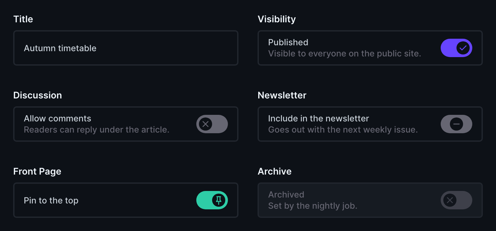

# directus-extension-switch

[](https://www.npmjs.com/package/directus-extension-switch)
[](https://opensource.org/licenses/MIT)

A switch interface for boolean fields in [Directus](https://directus.io). The field is a box with a label and a line of description at the start and an on/off switch at the end, and a click anywhere in the box flips the value. It is for fields which read like settings, such as "Published" or "Allow comments", where a sentence which says what the switch does is worth more than a checkbox, and it is as tall as a stock input, so it lines up with the fields beside it.


## Features

- **A label and a description.** The label is the first line. The description is a second, quieter line which says what the switch does. Both wrap when they are long, and the box grows with them.
- **Fits the form.** The box takes its height, border, radius, colours and its hover and disabled looks from the same theme tokens as the stock inputs. With one line of label, or a label and one line of description, it is exactly as tall as a stock input.
- **Three states.** On, off, and not set: a field which holds `null` shows its knob in the middle of the track with a dash, so "no answer yet" cannot be mistaken for "no". The first click turns it on.
- **One real button.** The whole box is a `button` with the `switch` role. Enter and Space flip it, the app's own focus ring shows on the box, and a screen reader hears the name of the field, the label, the description and the state, so two switches which both say "Enabled" are still told apart.
- **Read-only done properly.** A read-only field is dimmed, skipped by the Tab key and never changes. In the comparison of revisions the switch keeps its full colours and is just as inert.
- **Your icons and colours,** or none: an icon which is cleared leaves a plain knob.
- **The same data as the stock Toggle.** The field stores `true` or `false`, and the options use the Toggle's keys, so a field can move between the two interfaces without touching its data.
- **Looks like Directus** in light, dark and custom themes, follows right-to-left languages, and does not animate for people who ask for less motion.
- **Contrast themes and print.** Under a contrast theme of the system (forced colours) the track and the knob are drawn in the system's colours, and on, off and not set can be told apart without an icon. A printed form keeps the track and the knob of every switch.
- **Self-contained.** One app extension of about 11 kB (3.6 kB gzipped) which imports only `vue` and `@directus/extensions-sdk`.



## Installation

Choose one:

- **Marketplace.** In Directus go to Settings, Marketplace, search for `switch` and install. App-only extensions such as this one are listed under the default `MARKETPLACE_TRUST` setting.
- **npm.** In the project that runs Directus run `npm install directus-extension-switch`. Directus discovers extensions listed in the root `package.json` on startup.
- **Local folder.** Run `npm pack directus-extension-switch`, unpack the archive into `<EXTENSIONS_PATH>/directus-extension-switch` (`EXTENSIONS_PATH` defaults to `./extensions`) with `tar -xzf directus-extension-switch-*.tgz --strip-components 1 -C <that folder>`, then restart Directus.

## Usage

1. Restart Directus if you installed via npm or a local folder, and reload the Data Studio, which fetches extensions once when it starts.
2. Settings, Extensions: confirm **directus-extension-switch** is enabled.
3. Settings, Data Model, open a collection and create a field. Choose **Switch**, in the "Selection" group. The field is stored as a boolean. To use it for a field which already exists, open the field and set **Interface** to **Switch**.
4. Set the options below, and under Display pick **Boolean**, which the interface suggests.

| Option | Key | Default | Description |
|---|---|---|---|
| Label | `label` | "Enabled", in the user's language | The first line of the box, and what a screen reader announces after the name of the field. An empty label gives the default. |
| Description | `description` | none | A second line under the label, in a quieter colour. Left out when empty. |
| Icon On | `iconOn` | `check` | The icon in the knob while the switch is on. Clear the icon for a plain knob, which is stored as `null`. |
| Icon Off | `iconOff` | `close` | The same while it is off. |
| Color On | `colorOn` | the primary colour of the theme | The colour of the track, and of the icon in the knob, while the switch is on. |
| Color Off | `colorOff` | grey, the quiet text colour of the inputs | The same while it is off. |

The keys are what the field stores under `meta.options`, for a schema which is written by hand or applied from a file. All but `description` are also the keys of the stock Toggle, with the same meaning, so a field which moves from the Toggle to the Switch keeps its label, icons and colours.

Label and Description can be typed in, or picked from the translation strings of the project, as in the stock interfaces.

An icon is one of the icon picker. A name which Directus has no icon for, which only a schema written by hand can hold, shows as the first letter of the name in the knob and never outside it.

A colour is a hex colour, which is what the colour picker writes, or a theme variable such as `var(--theme--success)`, which follows the light and dark themes and can be typed into the field of the colour picker. Anything else is ignored and the default is used.

A screen reader hears the name of the field and then the label, "Newsletter Enabled", since the label alone is the same on every field which keeps the default. Where the two say the same, it is said once.

The description is the place for what the switch does. The note of the field, which the form prints under every interface, is left as it is and not repeated in the box.

## The value

The field holds `true` or `false`, exactly as with the stock Toggle, so nothing changes for the API, for filters or for the Boolean display.

A field which holds `null`, such as one on a new item without a default value, is drawn as not set. The switch itself never writes `null`: the first click or key press writes `true`. To take an answer away again use **Clear Value** in the menu of the field's label.

A value which is none of the three can only come from outside the app: a boolean field which was created without the app hands its value back as `0` or `1`, and a row of a Repeater or an import can hold text. The switch reads such a value by the rule Directus itself uses to turn a value into a boolean: `1`, `"1"` and `"true"` are on, and everything else is off, `"false"` and `"0"` included. The next change writes a real boolean.

## Compatibility

Built and tested against Directus 11.17.4. The `host` range `^11.15.0` is the one every package of the [repository](https://github.com/dkrutsko/directus-extensions) declares, and no other version was tried: not an earlier one of that range, and not Directus 12. The comparison of revisions relies on the `nonEditable` state which the form hands to an interface there.

Tested in Chrome only, not yet in Firefox or Safari, and not with a screen reader. Contrast themes and print were tried as Chrome emulates them, not with a contrast theme of Windows or on paper.

## Limitations

- There is no way to set a field back to `null` from the switch itself. The menu of the field's label does it.
- The knob cannot be dragged. It is a button: click it or press a key.
- A field which is not set looks the same whatever its colours and icons are, by design, and cannot be styled.
- Under a contrast theme of the system the colours of the options are not shown: the system's colours stand in, which is what such a theme is for.
- The interface is a form field only. In layouts the value is shown by the display of the field: pick Boolean.

## Development

This package lives in the [directus-extensions](https://github.com/dkrutsko/directus-extensions) repository, whose README covers the setup, the test Directus and releasing. The test Directus has a demo of the switch with every option side by side, [described in its README](https://github.com/dkrutsko/directus-extensions/blob/main/sandbox/README.md#demos). After `npm install` in the repository root, run these in `packages/switch`:

```bash
npm run dev       # watch build, unminified
npm run check     # vue-tsc, then tsc over the tests
npm test          # vitest
npm run build
npm run validate
```

The code is laid out as follows:

- `src/index.ts` declares the interface and its options, `src/interface.vue` is the component with its template and styles, and `src/preview.ts` is the drawing in the interface picker.
- `src/switch.ts` is everything which needs no browser: which state a value is, what a toggle writes, when the switch is inert or dimmed, what it is called, and what the options come to, including the check of the colours. It uses no Vue, DOM or Directus APIs, so the tests run it in Node.
- `tests` holds the unit tests of `src/switch.ts` and the guards of the styles and the built bundle, and `sandbox` the browser tests which run in a real Directus.

The [changelog](https://github.com/dkrutsko/directus-extensions/blob/main/packages/switch/CHANGELOG.md) lists what each release changed.

## License

[MIT](https://github.com/dkrutsko/directus-extensions/blob/main/packages/switch/LICENSE)
