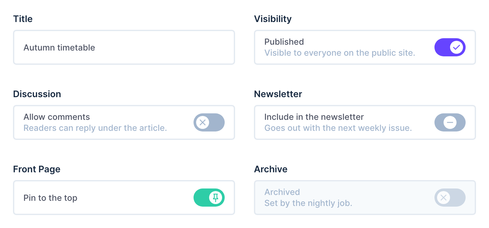

# directus-extension-switch

[](https://www.npmjs.com/package/directus-extension-switch)
[](https://opensource.org/licenses/MIT)

A switch interface for boolean fields in [Directus](https://directus.io). The field is a box with a label and a line of description at the start and an on/off switch at the end, and a click anywhere in the box flips the value. It is for fields which read like settings, such as "Published" or "Allow comments", where a sentence which says what the switch does is worth more than a checkbox, and it is as tall as a stock input, so it lines up with the fields beside it.



## Features

- **A label and a description.** The label is the first line. The description is a second, quieter line which says what the switch does. Both wrap when they are long, and the box grows with them.
- **Fits the form.** The box takes its height, border, radius, colours and its hover and disabled looks from the same theme tokens as the stock inputs. With one line of label, or a label and one line of description, it is exactly as tall as a stock input.
- **Three states.** On, off, and not set: a field which holds `null` shows its knob in the middle of the track with a dash, so "no answer yet" cannot be mistaken for "no". The first click turns it on.
- **One real button.** The whole box is a `button` with the `switch` role. Enter and Space flip it, the app's own focus ring shows on the box, and a screen reader hears the label, the description and the state.
- **Read-only done properly.** A read-only field is dimmed, skipped by the Tab key and never changes. In the comparison of revisions the switch keeps its full colours and is just as inert.
- **Your icons and colours,** or none: an icon which is cleared leaves a plain knob.
- **The same data as the stock Toggle.** The field stores `true` or `false`, and the options use the Toggle's keys, so a field can move between the two interfaces without touching its data.
- **Looks like Directus** in light, dark and custom themes, follows right-to-left languages, and does not animate for people who ask for less motion.
- **Self-contained.** One app extension of about 11 KB which imports only `vue` and `@directus/extensions-sdk`.


## Installation

Choose one:

- **Marketplace.** In Directus go to Settings, Marketplace, search for `switch` and install. App-only extensions such as this one are listed under the default `MARKETPLACE_TRUST` setting.
- **npm.** In the project that runs Directus run `npm install directus-extension-switch`. Directus discovers extensions listed in the root `package.json` on startup.
- **Local folder.** Run `npm pack directus-extension-switch`, unpack the archive into `<EXTENSIONS_PATH>/directus-extension-switch` (`EXTENSIONS_PATH` defaults to `./extensions`) with `tar -xzf directus-extension-switch-*.tgz --strip-components 1 -C <that folder>`, then restart Directus. The archive holds `package.json` and `dist/`, which is all Directus needs at run time.

## Usage

1. Restart Directus if you installed via npm or a local folder, and reload the Data Studio, which fetches extensions once when it starts.
2. Settings, Extensions: confirm **directus-extension-switch** is enabled.
3. Settings, Data Model, open a collection and create a field. Choose **Switch**, in the "Selection" group. The field is stored as a boolean. To use it for a field which already exists, open the field and set **Interface** to **Switch**.
4. Set the options below, and under Display pick **Boolean**, which the interface suggests.

| Option | Default | Description |
|---|---|---|
| Label | "Enabled", in the user's language | The first line of the box, and the name a screen reader announces. An empty label gives the default. |
| Description | none | A second line under the label, in a quieter colour. Left out when empty. |
| Icon On | `check` | The icon in the knob while the switch is on. Clear the icon for a plain knob. |
| Icon Off | `close` | The same while it is off. |
| Color On | the primary colour of the theme | The colour of the track, and of the icon in the knob, while the switch is on. |
| Color Off | grey, the quiet text colour of the inputs | The same while it is off. |

Label and Description can be typed in, or picked from the translation strings of the project, as in the stock interfaces.

An icon is one of the icon picker. A name which Directus has no icon for, which only a schema written by hand can hold, shows as the first letter of the name in the knob and never outside it.

A colour is a hex colour, which is what the colour picker writes, or a theme variable such as `var(--theme--success)`, which follows the light and dark themes. Anything else is ignored and the default is used.

The description is the place for what the switch does. The note of the field, which the form prints under every interface, is left as it is and not repeated in the box.

## The value

The field holds `true` or `false`, exactly as with the stock Toggle, so nothing changes for the API, for filters or for the Boolean display.

A field which holds `null`, such as one on a new item without a default value, is drawn as not set. The switch itself never writes `null`: the first click or key press writes `true`. To take an answer away again use **Clear Value** in the menu of the field's label.

A boolean field which was created outside the app can hand its value back as `0` or `1`. Those are drawn as off and on, and the next change writes a real boolean.

## Compatibility

Built and tested against Directus 11.17.4. The `host` range starts at 11.15.0, the first release with the `nonEditable` state the comparison of revisions uses, but only 11.17.4 has been tested. It has not been run against Directus 12.

Tested in Chrome only, not yet in Firefox or Safari, and not with a screen reader.

## Limitations

- There is no way to set a field back to `null` from the switch itself. The menu of the field's label does it.
- The knob cannot be dragged. It is a button: click it or press a key.
- A field which is not set looks the same whatever its colours and icons are, by design, and cannot be styled.
- The one fixed text of the interface, "Not set", which a screen reader announces for a field without an answer, is in English only.
- The interface is a form field only. In layouts the value is shown by the display of the field: pick Boolean.

## Development

This package lives in the [directus-extensions](https://github.com/dkrutsko/directus-extensions) repository, whose README covers the setup, the test Directus and releasing. After `npm install` in the repository root, run these in `packages/switch`:

```bash
npm run dev       # watch build, unminified
npm run check     # vue-tsc, then tsc over the tests
npm test          # vitest
npm run build
npm run validate
```

The code is laid out as follows:

- `src/index.ts` declares the interface and its options, `src/interface.vue` is the component with its template and styles, and `src/preview.ts` is the drawing in the interface picker.
- `src/switch.ts` is everything which needs no browser: which state a value is, what a toggle writes, and what the options come to, including the check of the colours. It uses no Vue, DOM or Directus APIs, so the tests run it in Node.
- `tests` holds the unit tests of `src/switch.ts`, and `sandbox` the browser tests which run in a real Directus.

## License

[MIT](https://github.com/dkrutsko/directus-extensions/blob/main/packages/switch/LICENSE)
